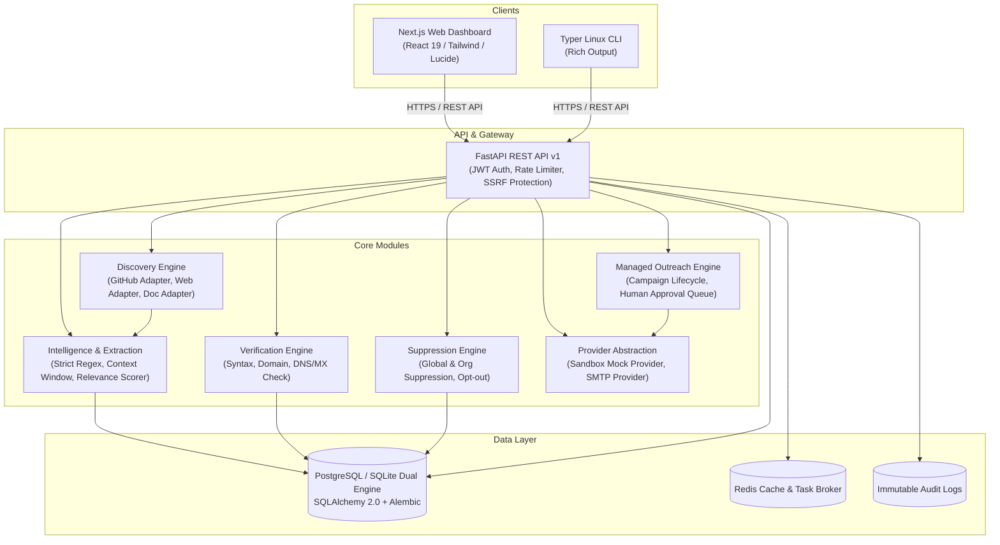
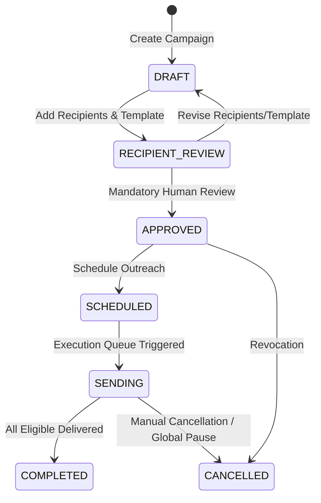

# MailRadar — System Architecture

## 1. Overview & Product Vision

**MailRadar** is a professional, self-hostable Developer Outreach Intelligence Platform. It empowers open-source maintainers, developer advocates, and technology organizations to discover relevant open-source projects, identify officially published contact channels, verify contact validity with strict provenance, manage recipient suppression, and coordinate personalized outreach campaigns with mandatory human-in-the-loop approval.

MailRadar adheres to strict ethical standards:
- **Zero indiscriminate scraping**: Only official, permitted repositories, documentation, and project websites are scanned.
- **Strict provenance**: Every single contact record preserves source URL, timestamp, category, and evidence snippet.
- **Privacy & Compliance**: No personal Gmail harvesting, no residential or private account enumeration, full suppression list enforcement, and mandatory unsubscribe headers.
- **Human Approval**: Automated mass-mailing is prohibited; campaigns require human review and individual recipient approval.

---

## 2. High-Level Architecture Diagram

---

## 3. Technology Stack

| Layer | Technology | Purpose |
| :--- | :--- | :--- |
| **Frontend** | Next.js 15, TypeScript, Tailwind CSS, Lucide icons, Framer Motion | Modern, dark-first developer dashboard |
| **Backend API** | Python 3.12+, FastAPI, Pydantic v2, SQLAlchemy 2.0 | Asynchronous REST API with strict schemas |
| **CLI** | Python Typer, Rich | Full-featured Linux CLI matching web capabilities |
| **Database** | PostgreSQL 16 (production), SQLite (local dev/test) | Normalized relational storage with UUID PKs |
| **Queue / Cache** | Redis 7, Celery / Asynchronous Task Runner | Background discovery and email delivery queues |
| **Discovery** | GitHub REST API, BeautifulSoup4, HTTPX | Official source scanning with SSRF guards |
| **DevOps** | Docker, Docker Compose, GitHub Actions | Multi-container deployment and CI workflows |

---

## 4. Key Architectural Subsystems

### 4.1. Security & SSRF Protection
- **Private Network Blocking**: IP addresses in RFC 1918 (10.0.0.0/8, 172.16.0.0/12, 192.168.0.0/16), loopback (127.0.0.0/8), link-local (169.254.0.0/16), and cloud metadata (169.254.169.254) are rejected before HTTP requests are issued.
- **Safe Redirects**: Redirect chains are validated at every hop to prevent open-redirect SSRF pivoting.
- **Domain Allowlisting & robots.txt**: Crawl scopes are bound strictly to official project domains and documentation endpoints.

### 4.2. Contact Extraction & Provenance
- Contacts are extracted exclusively when associated with maintainer, developer, or official collaboration context.
- Extraction produces a `ContactSource` record linking the email to:
  - Exact source URL.
  - Source category (`GITHUB_README`, `CONTRIBUTING_GUIDE`, `OFFICIAL_WEBSITE`, `DOCS`).
  - Contextual snippet / evidence text.
  - Extraction timestamp.
- High-risk / personal generic addresses without explicit maintainer attribution are scored lower or flagged.

### 4.3. Verification Architecture
- Three-tier verification pipeline:
  1. RFC 5322 Syntax validation.
  2. Domain format & TLD existence check.
  3. DNS MX record validation (with mock/fallback mode for offline or sandboxed testing).
- Verification results are recorded in `verification_records` with unambiguous status: `VALID`, `NO_MX`, `INVALID_SYNTAX`, `DISPOSABLE`, or `UNCHECKED`. No false claims of mailbox presence.

### 4.4. Campaign Lifecycle & Human-in-the-Loop Approval

- **Suppression Gate**: Before sending any message, the worker checks:
  1. Recipient is not in global or organization suppression list.
  2. Recipient has not opted out or replied with negative sentiment.
  3. No duplicate message has been sent to this recipient in this campaign.
  4. Explicit approval status is `APPROVED`.
- **Delivery Providers**:
  - `SandboxProvider`: Safely captures all payloads locally with zero network egress for testing and simulation.
  - `SmtpProvider`: Standard TLS-encrypted SMTP delivery with rate limiting, retry headers, and bounce detection.

---

## 5. Normalized Relational Schema

MailRadar entities use UUID primary keys, foreign key constraints, UTC timestamps, and tenant isolation:

1. `users`: Multi-tenant user accounts with bcrypt hashed passwords and role-based permissions (`ADMIN`, `OPERATOR`, `VIEWER`).
2. `organizations`: Tenant boundary for projects, contacts, templates, and campaigns.
3. `projects`: Discovered or tracked GitHub repositories and open-source initiatives.
4. `contacts`: Extracted professional developer contacts.
5. `contact_sources`: Provenance records capturing source URL, snippet evidence, and category.
6. `discovery_jobs`: Execution tracking for background scanning tasks.
7. `verification_records`: Audit trail of syntax, DNS, and MX checks.
8. `suppression_entries`: Permanent suppression list preventing outreach.
9. `email_templates`: Personalized outreach templates with variable interpolation.
10. `campaigns`: Outreach campaigns with lifecycle states.
11. `campaign_recipients`: Per-recipient message state, approval state, and delivery status.
12. `message_events`: Delivery, bounce, reply, and unsubscribe event audit logs.
13. `connected_accounts`: Encrypted credentials for discovery & delivery providers.
14. `audit_logs`: Immutable security action log.
