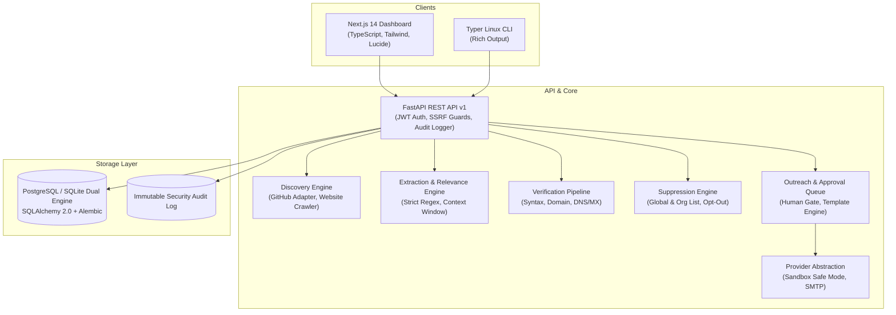

# MailRadar — Developer Outreach Intelligence Platform

<p align="center">
  <strong>An ethical, self-hostable intelligence platform for discovering relevant open-source projects, identifying explicitly published maintainer contacts with strict provenance, and managing human-approved personalized collaboration outreach.</strong>
</p>

---

## 1. Product Overview

**MailRadar** helps developers, engineering leaders, and open-source organizations discover relevant repositories, inspect permitted official project documentation, extract explicitly published professional contacts, verify DNS/MX deliverability, and coordinate outreach campaigns with **mandatory human approval**.

MailRadar is designed with an ethical foundation:
- **Zero Indiscriminate Scraping**: Only official GitHub repositories, READMEs, CONTRIBUTING guidelines, and permitted project websites are inspected.
- **Strict Provenance**: Every single contact retains its exact source URL, category, extraction timestamp, and verbatim evidence snippet.
- **Mandatory Human-in-the-Loop**: Automated bulk mailing is prohibited. Every message draft must be reviewed and individually approved before sending.
- **Guaranteed Suppression**: Permanent suppression list enforcement and one-click unsubscription mechanisms protect recipient preferences.
- **SSRF Hardened**: Built-in network boundary filters block loopback, RFC 1918 private subnets, and cloud metadata access.

---

## 2. Architecture Overview

MailRadar is structured as a modular monolith with asynchronous execution capabilities:



---

## 3. Technology Stack

- **Web Dashboard**: Next.js 14, React 18, TypeScript, Tailwind CSS, Lucide icons, Framer Motion
- **Backend REST API**: Python 3.12+, FastAPI, Pydantic v2, SQLAlchemy 2.0, Alembic
- **Linux CLI**: Python Typer, Rich
- **Database**: PostgreSQL 16 (production), SQLite (local dev & testing)
- **Queue & Workers**: Redis 7, Celery / Async workers
- **Discovery & Parsing**: GitHub REST API, BeautifulSoup4, HTTPX
- **Delivery Providers**: Sandbox Provider (default safe mode), SMTP Provider
- **Testing**: Pytest, TestClient, HTTPX

---

## 4. Quickstart: One-Command Execution

MailRadar provides simple one-command launchers:

### 4.1. Run the Web-Based Version (Dashboard + API)
```bash
./mailradar-web
# or
make web
# or
mailradar web
```
This single command automatically starts both the **FastAPI REST API** and the **Next.js Web Dashboard**:
- **Web Dashboard**: `http://localhost:3000`
- **REST API & Swagger Docs**: `http://localhost:8000/docs`

### 4.2. Run the Linux CLI Version
```bash
./mailradar-cli doctor
# or
./mailradar-cli --help
# or
make cli
```

---

## 5. Manual Setup Guide (Alternative)

### 5.1. Prerequisites
- Python 3.12, 3.13, or 3.14
- Node.js v20+ with npm
- Git

### 5.2. Backend Setup
```bash
# Clone the repository
git clone https://github.com/ashishsinghbora/MailRadar.git
cd MailRadar

# Create and activate Python virtual environment
python3 -m venv .venv
source .venv/bin/activate

# Install backend in editable mode with dev dependencies
pip install -e .[dev]

# Configure environment variables
cp .env.example .env

# Run database migrations
alembic upgrade head

# Start FastAPI development server
uvicorn backend.api.main:app --host 0.0.0.0 --port 8000 --reload
```
API Documentation will be live at `http://localhost:8000/docs`.

### 5.3. Frontend Setup
```bash
# In a new terminal:
cd apps/web
npm install
npm run dev
```
The Web Dashboard will be accessible at `http://localhost:3000`.

---

## 6. Linux CLI Usage

MailRadar provides a rich Typer-based CLI for developer workflows:

```bash
# System Diagnostics & Health Check
./mailradar-cli doctor

# Initialize Organization Configuration
mailradar config init

# Discover Repositories & Maintainers via GitHub
mailradar discover github "distributed consensus" --limit 5

# View Discovered Projects
mailradar projects list
mailradar projects show <project_id>

# Manage Professional Contacts
mailradar contacts list
mailradar contacts show <contact_id>
mailradar contacts sources <contact_id>
mailradar contacts export --format csv

# Manage Outreach Campaigns & Approval Queue
mailradar campaign create "Mesh Maintainers Outreach"
mailradar campaign preview <campaign_id>
mailradar campaign approve <recipient_id>
mailradar campaign status <campaign_id>

# View Suppression List
mailradar suppression list
```

---

## 6. Docker Compose Deployment

To deploy the entire production stack (PostgreSQL, Redis, FastAPI Backend, and Next.js Web Dashboard):

```bash
docker compose up --build -d
```

- **Web Dashboard**: `http://localhost:3000`
- **Backend API & Swagger**: `http://localhost:8000/docs`
- **PostgreSQL**: `localhost:5432`
- **Redis**: `localhost:6379`

To view logs:
```bash
docker compose logs -f backend
```

---

## 7. Security & Compliance Architecture

MailRadar adheres to strict security standards:
- **SSRF Defense**: Automatically inspects destination IP addresses and blocks private ranges (`10.0.0.0/8`, `172.16.0.0/12`, `192.168.0.0/16`), loopback (`127.0.0.0/8`), link-local / cloud metadata (`169.254.169.254`), and IPv6 equivalents.
- **Credential Encryption**: Connected provider API keys and tokens are encrypted at rest using Fernet symmetric encryption.
- **Human Approval Gate**: Outreach cannot be sent without human review. The campaign execution engine hard-blocks unapproved recipient entries.
- **Suppression Gate**: Checks both global blocklists and organization suppression entries before every message is formatted or transmitted.
- **Audit Logging**: Every administrative action, authentication attempt, discovery execution, and campaign dispatch is preserved in an immutable audit ledger.

---

## 8. Running Automated Tests

Run the full Pytest test suite:
```bash
pytest -v
```

Run test suite with coverage:
```bash
pytest --verbose tests/
```

Test categories:
- `tests/unit/test_ssrf.py`: SSRF boundaries, private IP blocking, safe URL validation.
- `tests/unit/test_extractor.py`: Strict email regex extraction, noise filtering, relevance scoring.
- `tests/unit/test_verifier.py`: Syntax checking, disposable domain detection, DNS MX lookup.
- `tests/unit/test_suppression.py`: Global and organization suppression, unsubscribe token decoding.
- `tests/unit/test_renderer.py`: Template interpolation, Markdown to HTML rendering.
- `tests/unit/test_cli.py`: Typer CLI command execution and exit code assertions.
- `tests/integration/test_api.py`: FastAPI endpoints, registration, login, projects, contacts export.
- `tests/integration/test_campaigns.py`: Full campaign lifecycle, mandatory human approval gate, sandbox delivery, idempotency duplicate prevention.

---

## 9. Documentation

- [System Architecture](ARCHITECTURE.md)
- [Developer Setup & Guide](DEVELOPMENT.md)
- [Product Roadmap](ROADMAP.md)
- [Changelog](CHANGELOG.md)
- [Security Policy](SECURITY.md)
- [Privacy & Ethical Standards](PRIVACY.md)
- [Contributing Guidelines](CONTRIBUTING.md)

---

## 10. License

MailRadar is open-source software licensed under the [Apache-2.0 License](LICENSE).
